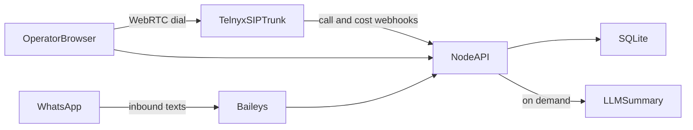

# Telnyx and Baileys

A local web app on a Node API. People sign in, buy Telnyx numbers, and place calls against a balance an admin approves. Baileys links one WhatsApp account for the admin.

## Product

- **Accounts.** People sign up and sign in. The first account is the admin. Later accounts are users.
- **Numbers.** A signed-in user can search Telnyx's available-number inventory and buy a number onto their account. The charge comes out of their balance.
- **Credit.** A user requests an amount. The admin approves or rejects it. Approval credits that user's balance. Calls and number purchases draw the balance down.
- **Dashboard.** Each user sees balance, amount spent, where it went, and Telnyx minutes.
- **Calls.** A user with a balance dials from the browser over the Telnyx credential connection. Each call is stored with status, duration, and the cost Telnyx reports.
- **WhatsApp.** One linked account via Baileys, visible to the admin. Inbound texts are stored. Each chat shows stats, a message count, and an on-demand summary. One-to-one chats can auto-reply from the pattern learned from the admin's own texts.
- **Billing.** The in-app balance is credit an admin approves. The app does not charge a card. Call prices shown are the Telnyx cost.

## Out of scope

- **SMS.** No Telnyx messaging. Phone work is SIP voice calls only.
- **Call audio recording.** Telnyx stores recordings when enabled on the connection/outbound voice profile. The app stores the recording URL metadata, proxies playback to admins, and can generate an admin-only Gemini summary.
- **Per-user WhatsApp.** There is one linked WhatsApp account, and only the admin can open it.

## Calls

The browser uses the Telnyx WebRTC SDK. The server mints a short-lived telephony token from `TELNYX_API_KEY` so the SIP password stays on the server. Caller ID is the Telnyx number on that connection.

Telnyx webhooks on the connection update the call row:

- `call.initiated`, `call.answered`, and `call.hangup` set status and timestamps.
- Duration is answered-to-hangup, stored in seconds and shown in minutes. Unanswered calls store `0`.
- `call.cost` sets billed seconds, amount, and currency. Until that webhook arrives, cost stays pending. Telnyx prices the call after hangup.
- A refresh action pulls the Telnyx detail record by call session id if the cost webhook never arrives.

Stored per call: Telnyx session and leg ids, direction, from, to, started / answered / ended timestamps, duration, billable seconds, cost, currency, hangup cause, and status. Outbound dialing is the feature. Inbound legs are stored with the same shape if Telnyx sends them.

## WhatsApp

Baileys runs inside the API process. Auth state lives in `data/baileys-auth`. The dashboard shows a QR code until the session is linked, then connection status.

On `messages.upsert`, persist inbound text only (`conversation` and extended text). Each row stores the WhatsApp message id, chat JID, sender, push name, body, and timestamp. Images, audio, and other non-text messages are ignored for v1.

Per chat, always computed from stored rows (no model call):

- message count
- first and last message time
- last text preview
- display name

**Generate summary** sends that chat’s stored transcript to Gemini with `GEMINI_API_KEY`. If the transcript exceeds the cap, the oldest texts are dropped first. The result is saved with the model name, the time it was generated, and the message count at generation, so the UI can show when a summary is stale. Stats stay visible even when no summary exists yet.

Groups are chats keyed by JID. Message count is inbound texts for that chat. The dashboard also shows a total inbound text count.

## API and screens

- Telephony token, `GET /api/calls`, `GET /api/calls/:id`, `POST /api/calls/:id/refresh-cost`
- `POST /api/telnyx/webhook` (Ed25519 signature check)
- Admin calls, recording playback, and recording summary: `GET /api/admin/calls`, `GET /api/admin/calls/:id/recording`, `POST /api/admin/calls/:id/summary`
- `GET /api/whatsapp/status`, QR code as server-sent events
- `GET /api/whatsapp/chats`, `GET /api/whatsapp/chats/:jid/messages`
- `POST /api/whatsapp/chats/:jid/summary`

Screens:

- **Calls.** Number entry, call, hang up, live state, and history with minutes and cost.
- **WhatsApp.** Link status, chat list with counts, transcript, stats, and generate summary.
- **Home.** Totals for minutes, cost, and inbound text count.
- **Admin calls.** All saved calls, recordings, and Gemini-generated summaries.

## Stack

- API: Node.js, TypeScript, Fastify, SQLite (`data/app.db`)
- WhatsApp: [WhiskeySockets/Baileys](https://github.com/WhiskeySockets/Baileys.git) at commit `81345beb67ca3fb0eb79a2c20cd4ac24da517929`, imported as `baileys`
- Voice: `telnyx` server SDK and `@telnyx/webrtc` in the browser
- UI: Vite and React
- Summary: Gemini, using `GEMINI_API_KEY` and `GEMINI_MODEL` (default `gemini-3.6-flash`). The stored chat transcript is what gets sent.
- Config via `.env`: Telnyx API key, public key, connection id, phone number, and the LLM settings

